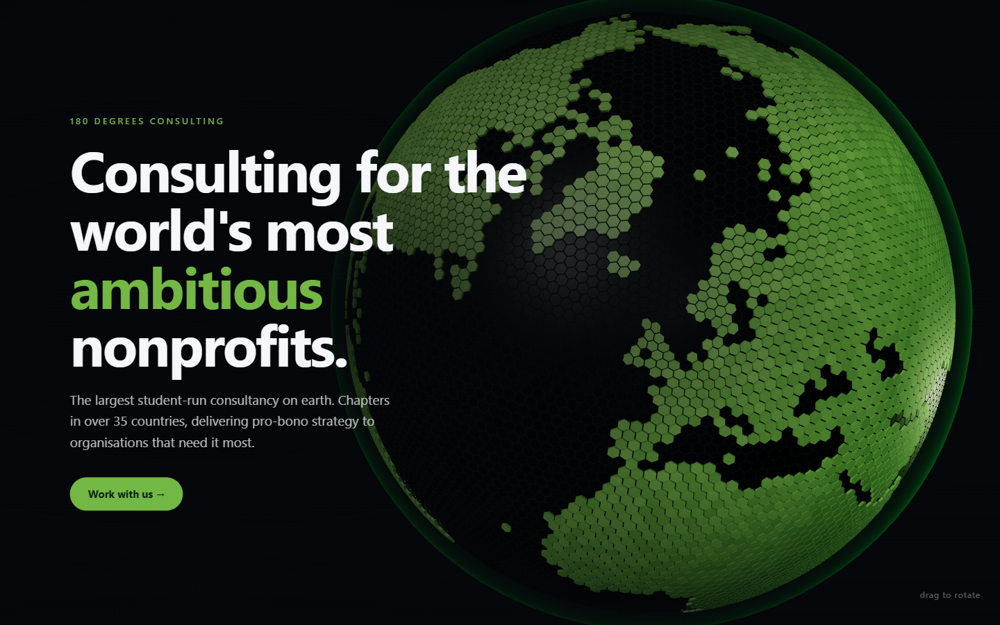

# Cyber Globe — 180DC MUJ

> Branch `feat/3d-render`. Lives in `globe/` until it is mounted into the site shell.
> Vercel preview: open `/globe/` on this branch's preview URL.

An interactive hex-tiled globe for use as a website background. Green landmasses in the
180 Degrees Consulting brand green, near-black hex-textured ocean, drag to rotate.



`index.html` is the deliverable: one self-contained file, no build step, no assets to host.
Open it in a browser and it runs.

## Brand colours

Pulled from the live stylesheet at `180dc.org`, not guessed:

| Token | Hex | Used for |
|---|---|---|
| `--bright-green` | `#73B744` | landmasses, headline accent, CTA |
| `--jade-green` | `#049648` | atmosphere limb glow |
| `--dim-grey` | `#414042` | — (available, unused here) |

Source: `cdn.prod.website-files.com/63b610d81215b25001c51b2b/css/180-degrees-consulting.webflow.shared.dcaf4bd88.css`

## How the globe is built

**The tiling is a Goldberg polyhedron.** An icosahedron is subdivided into a geodesic
triangle mesh, then the *dual* of that mesh is taken: one polygon per triangle-vertex,
with its corners at the surrounding face centroids. That yields hexagons everywhere
except at the 12 original icosahedron vertices, which are necessarily pentagons — you
cannot tile a sphere with hexagons alone, and any implementation claiming otherwise is
hiding its pentagons or distorting its hexagons. At the default frequency the pentagons
are a twelfth of a percent of the surface and invisible in motion.

**Land comes from a real coastline.** Natural Earth 50m land polygons, rasterised to a
2048×1024 1-bit equirectangular mask, base64-embedded in the HTML (~27KB). Each cell's
centre is converted to lat/lon and sampled against it. Land cells extrude 0.7% of the
radius and get side walls so the edges catch the key light.

**Texture is per-cell tint jitter**, not a texture map — each tile picks a brightness
multiplier within ±20%, which is what stops the ocean reading as flat black.

## Dropping it into a site

Copy three things out of `index.html`:

1. `<canvas id="globe-canvas">` — position it `fixed; inset: 0; z-index: 0`
2. The `<script type="module">` block, including the `LANDMASK_URI` constant
3. Optionally `#vignette`, the scrim that keeps foreground text legible

Your content sits above it at a higher `z-index`. Give the content container
`pointer-events: none` and its interactive children `pointer-events: auto`, so drags on
empty space reach the globe while buttons and links still work.

The canvas is transparent (`CONFIG.background = null`), so the page background shows
through. Set a hex value there instead if you want the globe to own its backdrop.

## Tuning

Everything lives in the `CONFIG` object at the top of the script.

| Key | Default | Effect |
|---|---|---|
| `frequency` | `38` | Cell count = `10f² + 2`. **16** = 2,562 chunky graphic tiles, **38** = 14,442 (fine texture), **52** = 27,042 (near-smooth, heavier) |
| `landColor` / `oceanColor` | `#73b744` / `#0e1210` | Pure black ocean kills the hex texture — keep it slightly lifted |
| `cellInset` | `0.10` | Gap between tiles. `0` = touching, `0.2` = wide grid |
| `landLift` | `0.007` | Land extrusion, fraction of radius |
| `tintJitter` | `0.20` | Per-cell brightness variation |
| `spinSpeed` | `0.045` | Idle rotation, rad/sec |
| `dragSpeed` | `0.0042` | Radians per pixel dragged |
| `inertiaDamping` | `0.94` | Throw decay. Lower = stops sooner |
| `cameraDistance` | `3.55` | Multiples of radius. Larger = smaller globe |
| `globeOffsetX` | `0.48` | Horizontal shift, so side copy has room. `0` = centred |
| `narrowZoomOut` / `narrowOffsetY` | `1.5` / `-0.55` | Under 900px: pull back and drop below the copy |
| `bloom` | `false` | Lazily imports three's postprocessing passes when enabled |

## Behaviour

- Drag to rotate, with inertia on release; idle spin resumes once the throw decays
- Vertical rotation clamps at ±1.05 rad so you can never flip past the poles
- Subtle camera parallax follows the cursor
- Pauses entirely when the tab is hidden or the canvas scrolls out of view
- `prefers-reduced-motion` disables idle spin and parallax; drag still works
- Device pixel ratio capped at 2

Inertia decay and parallax easing are normalised to elapsed time, so a throw travels the
same distance on a 144Hz monitor as on a 60Hz one.

## Measured

Chromium, 1440×900, integrated GPU:

```
cells             14,442   (4,268 land = 29.6% — matches Earth's real land fraction)
triangles        149,882
draw calls             4
build time        ~240 ms  (mask decode + dual construction + buffer fill)
frame rate         60 fps
index.html         50 KB   (27 KB of which is the embedded land mask)
```

Verified in-browser: drag maps exactly to `dragSpeed` (220px × 0.0042 = 0.924 rad),
inertia decays to zero, idle spin measures 0.0449 rad/s against 0.045 configured, pitch
clamp holds at exactly 1.05 under a 1200px shove.

## Rebuilding

Only needed if you change `globe.template.html` or the land mask. Requires
[uv](https://docs.astral.sh/uv/). Run from inside `globe/`.

```bash
uv run --with pillow python tools/build_landmask.py   # geojson -> mask png -> base64
uv run python tools/build.py                          # template + mask -> index.html
```

`build_landmask.py` spot-checks eight known coordinates (Paris, Sahara, Amazon, Mumbai,
Sydney should be land; mid-Pacific, mid-Atlantic, Indian Ocean should be ocean) and
prints `SPOTCHECK PASS/FAIL`. Never ship a mask that fails it — a silently flipped
longitude produces a globe that looks plausible and has the continents in the wrong place.

Edit `globe.template.html`, never `index.html` — the latter is generated and your changes
will be overwritten.

## Files

```
index.html               the deliverable, self-contained
globe.template.html      source; same file with __LANDMASK_B64__ as a placeholder
tools/build_landmask.py  Natural Earth geojson -> 1-bit equirect mask + base64
tools/build.py           inlines the mask into the template
tools/ne_50m_land.geojson, ne_110m_land.geojson   source coastlines
tools/landmask.png       the rasterised mask, for eyeballing
```
